<!--
SPDX-FileCopyrightText: 2026 LonerCatboy
SPDX-License-Identifier: CC0-1.0
-->

# Beveled

A complete desktop theme for KDE Plasma 6 in the style of the classic late-'90s desktops:
raised 3D buttons, gradient title bars, a gray window face and a docked taskbar at the bottom.

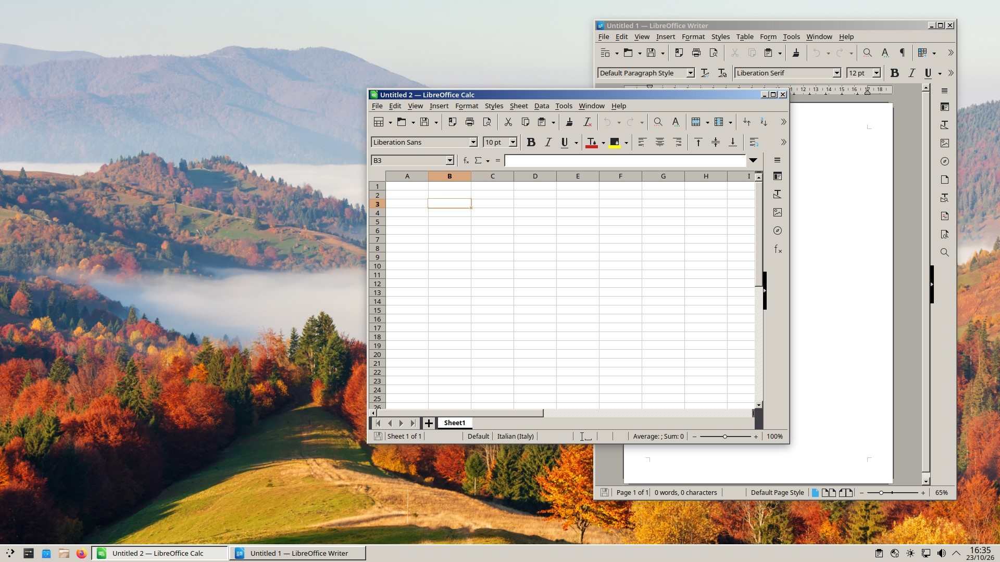

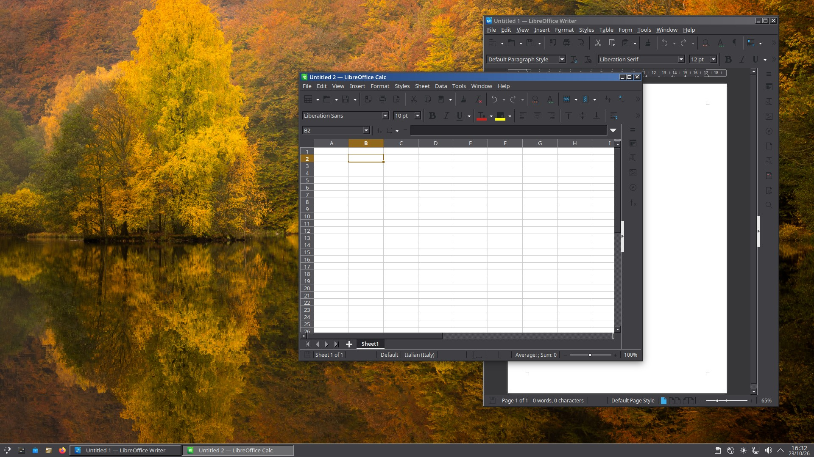

> **Status:** early development. The window decoration, color schemes and Plasma styles work;
> the application style is a first version.

## Why another retro theme

Most retro themes are made of svg, pictures, which get stretched to fit the screen, so edges turn soft
and blurry, especially on high-resolution displays. Beveled draws every edge itself, one screen
pixel at a time, so lines stay sharp at any size.

### Other features (some examples):

**Button hover:** optionally, caption buttons are drawn slightly pressed while the pointer is
  over them.

  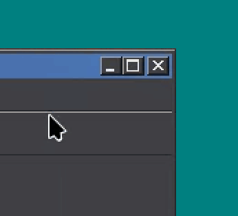


**Window frame:** soft (classic) or hard bevel.

  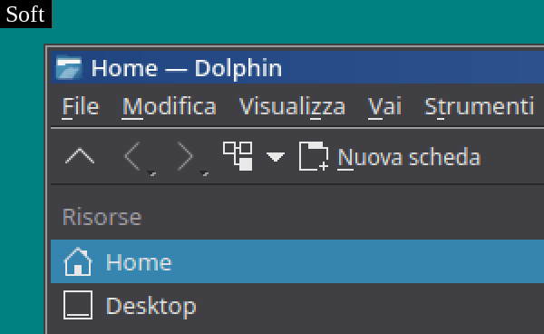

  | Soft | Hard |
  | --- | --- |
  | 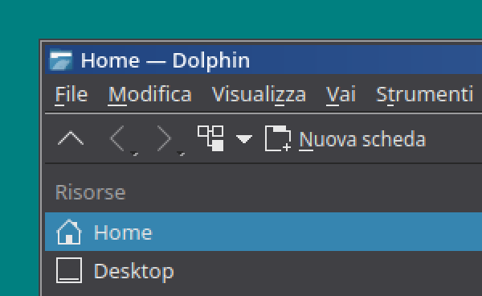 | 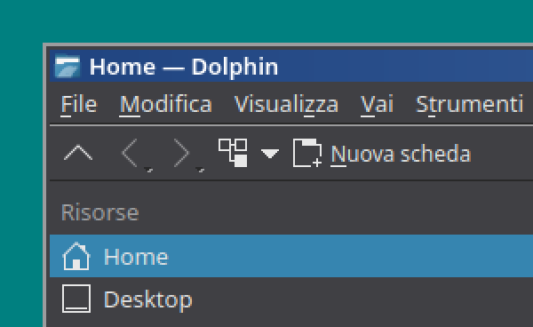 |


**Button bevel:** soft (classic) or hard, set separately from the window frame.

  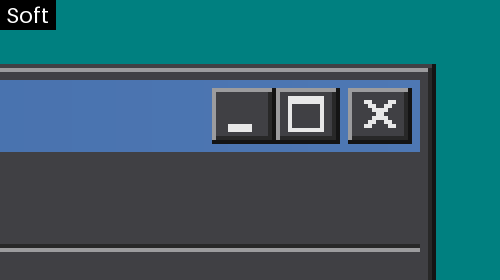

  | Soft | Hard |
  | --- | --- |
  | 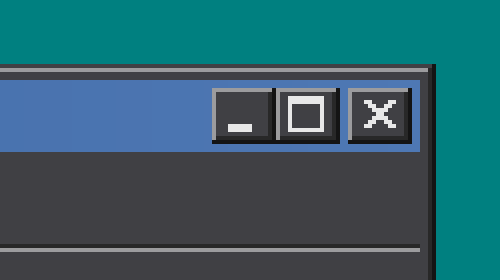 | 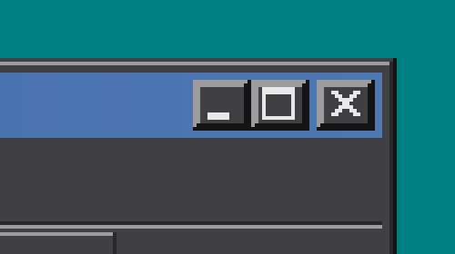 |


**Sunken frames** (application style): soft (classic) or hard, with a 2px light edge at the
  bottom and right.

  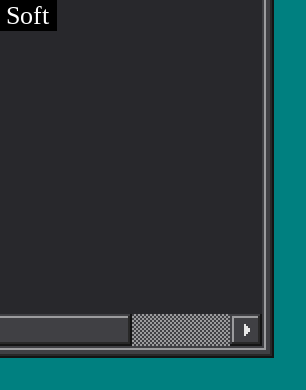 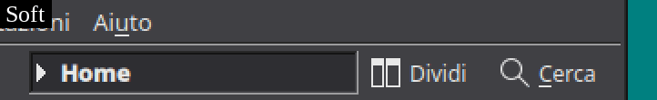

  | Soft | Hard |
  | --- | --- |
  | 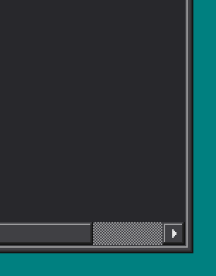 | 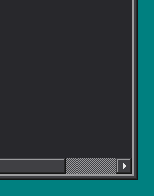 |
  |  | 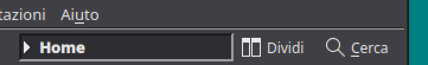 |


**Title bar:** gradient or solid, optional glossy finish, optional accent color, optional tint
  of inactive title bars with the active title color, adjustable title text weight.

**Shadows and transparency:** no shadow, soft shadow or solid drop shadow with adjustable
  distance; adjustable title bar and frame opacity (KWin blurs what is behind).
  
**Sizes:** bevel shade depth, space around buttons and space around symbols, each within a
  fixed range. The application style has similar options for button padding and layout spacing.

All window decoration options, in System Settings → Colors & Themes → Window Decorations →
Beveled:

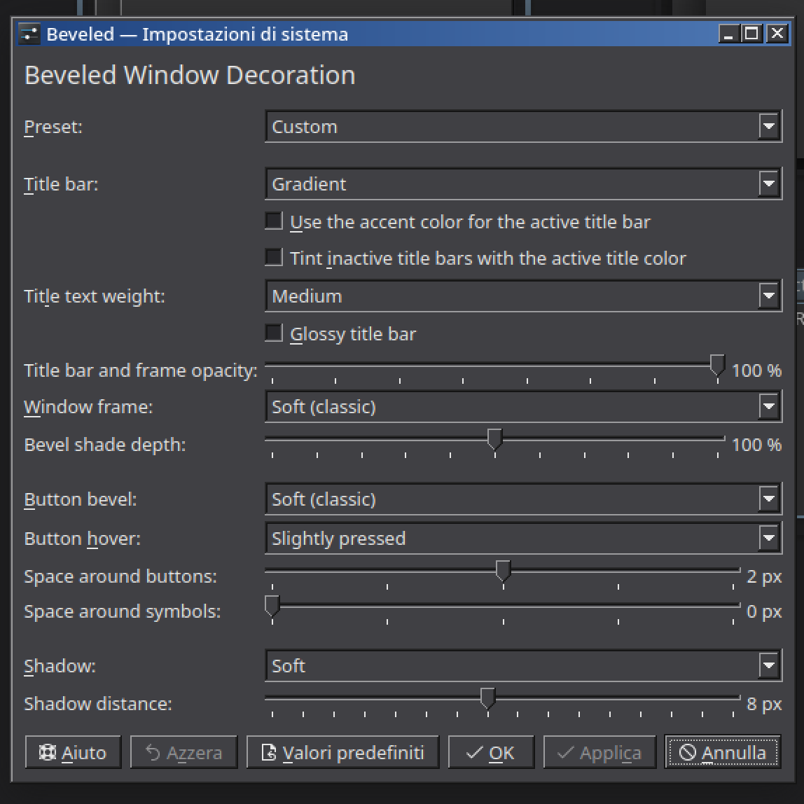

Sunken frames and some other minor tweaks are set from the application style settings.

## What's included

- **Global themes:** Beveled (light) and Beveled Dark, which apply everything below in one click,
  with a splash screen and an optional classic taskbar layout.
- **Window decoration:** beveled frame, gradient title bar and classic caption buttons, with
  options for colors, bevels, hover effects, shadows and transparency.
- **Application style:** classic look and compact spacing for KDE and Qt applications.
- **Plasma styles:** panel, task buttons, popups and tooltips, light and dark.
- **Color schemes:** Classic, Modern, Parchment and Dark.

Icons and cursors are not part of the theme yet. I don't plan featuring them in the future, though you can mix and match them with available icon packs and cursors.

## Made with Claude Code

Beveled is designed and tested by LonerCatboy and written with the help of
[Claude Code](https://claude.com/claude-code), Anthropic's AI coding assistant. It is by all intents and purposes a vibe coded project. It works on my machines, use it at your own risk.

## Installing

Beveled is not packaged yet, and it probably won't: it is built from source and installed system-wide, where Plasma
and System Settings find it. It needs Plasma 6.3 or later (Qt 6.8, KDE Frameworks 6.10). The only reason it exists is because I wanted a nice and clean beveled theme for my machine, since everyone else I tried was deeply unsatisfactory.

### 1. Build dependencies

Fedora:

```bash
sudo dnf install git cmake ninja-build gcc-c++ extra-cmake-modules python3 qt6-qtbase-devel \
  kf6-kconfig-devel kf6-kcoreaddons-devel kf6-kcolorscheme-devel kf6-kconfigwidgets-devel \
  kf6-kcmutils-devel kdecoration-devel
```

Other distributions: install CMake (3.25 or later), Ninja, a C++20 compiler, Python 3, Extra CMake Modules and
the development packages of Qt 6 (Core, Gui, Widgets), KDE Frameworks 6 (KConfig, KCoreAddons,
KColorScheme, KConfigWidgets, KCMUtils) and KDecoration 3. Ask your claude instance.

### 2. Build and install

```bash
git clone https://github.com/LonerCatboy/beveled.git
cd beveled
cmake --workflow --preset release
sudo cmake --install build-release
```

The first command configures and builds in `build-release/`, the second copies the result into
`/usr`. Keep the `beveled` folder: `build-release` records every installed file, which is what
makes a clean uninstall possible.

Then **log out and back in**, so that KWin and Plasma load the new components.

### 3. Choose the theme

The quickest way: System Settings → Colors & Themes → Global Theme → **Beveled** or
**Beveled Dark**. This sets the colors, window decoration, application and Plasma styles, the
splash screen and the wallpaper (Synevyr for Beveled, Skäralid for Beveled Dark; both are also
listed among the wallpapers). Tick "Use desktop layout from theme" there for the classic taskbar (this replaces
your current panels).

Each part can also be chosen on its own in System Settings:

| Part | Where | Choose |
|---|---|---|
| Colors | Colors & Themes → Colors | Beveled Classic, Modern, Parchment or Dark |
| Window decoration | Colors & Themes → Window Decorations | Beveled |
| Application style | Colors & Themes → Application Style | Beveled |
| Plasma style | Colors & Themes → Plasma Style | Beveled (light colors) or Beveled Dark (dark colors) |

The window decoration and the application style have their own options behind the edit or
Configure button next to them. They are stored in `~/.config/beveledrc`.

## Updating

```bash
cd beveled
git pull
cmake --workflow --preset release
sudo cmake --install build-release
```

Log out and back in afterwards.

## Uninstalling

1. In System Settings, switch to another global theme (for example Breeze), so that nothing
   points to Beveled any more.
2. Remove the installed files:

   ```bash
   cd beveled
   sudo cmake -P build-release/uninstall.cmake
   ```

   This removes every file installed from `build-release`, including files of older versions
   that later updates no longer install, and the Beveled folders that held them.
3. Optionally remove your Beveled options: `rm ~/.config/beveledrc`
4. Log out and back in.

If Beveled was still selected, Plasma simply falls back to its defaults.

If the session ever becomes unusable after installing, switch to a text console
(Ctrl+Alt+F3), log in and run the command of step 2, then reboot.

## Development

```bash
cmake --preset dev
cmake --build --preset dev
ctest --preset dev
```

The `dev` preset builds with tests in `build/`. To try the application style on a single
application without installing anything:

```bash
QT_PLUGIN_PATH=$PWD/build/bin kwrite -style beveled
```

## Licensing

The project follows the [REUSE](https://reuse.software/) specification:

- code: GPL-2.0-or-later
- artwork, including the Plasma style SVGs generated by `plasma/generate.py` and the previews:
  CC-BY-SA-4.0
- configuration files and documentation: CC0-1.0

Full license texts are in `LICENSES/`.

The wallpapers, included with the global themes and shown in the previews, are photos from
Wikimedia Commons, licensed CC BY-SA 4.0:

- light theme: [National Nature Park Synevyr, Ukraine](https://commons.wikimedia.org/wiki/File:21-224-5054_NNP_Synevyr_RB_18.jpg)
  by Roman Brechko
- dark theme: [Autumn in Skäralid, Söderåsen National Park, Sweden](https://commons.wikimedia.org/wiki/File:Sk%C3%A4ralid_in_S%C3%B6der%C3%A5sen_National_Park_121020_01.jpg)
  by Mats Brynolf

## Disclaimer

Independent project, not affiliated with or endorsed by Microsoft. It contains no Microsoft
assets, fonts or trademarks.
